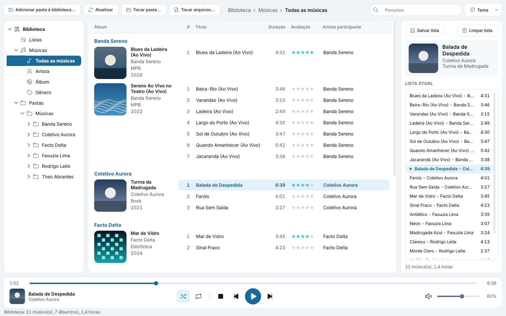
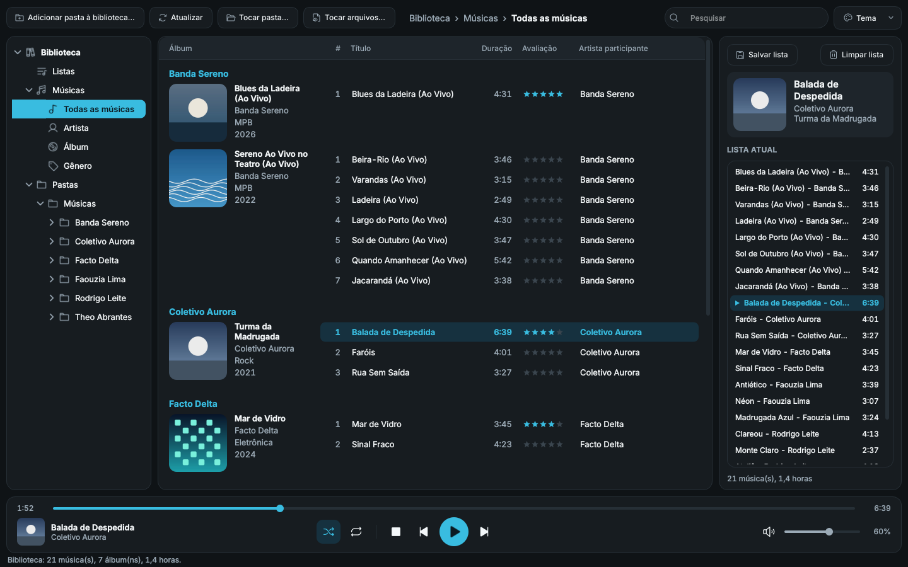
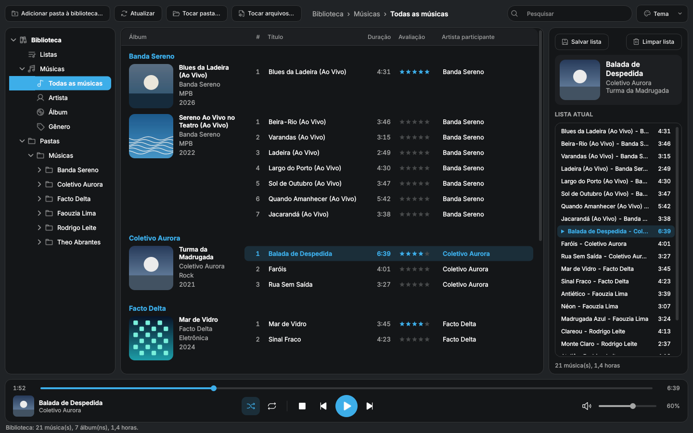
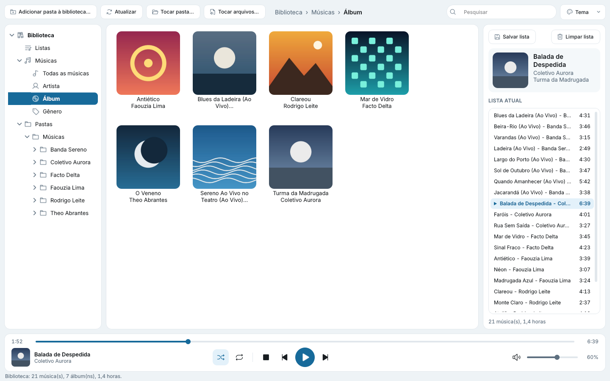

<p align="center">
  
</p>

<h1 align="center">Linux Music Player</h1>

<p align="center">
  Um tocador de músicas com biblioteca para Linux: capas, notas em estrelas, listas
  e integração com o Plasma. A janela clássica de biblioteca, com cartões arredondados
  e as cores da família LMP.
</p>

<p align="center">
  <a href="https://github.com/juscelino25bezerra-art/LinuxMusicPlayer/releases/latest"></a>
  <a href="https://github.com/juscelino25bezerra-art/LinuxMusicPlayer/actions/workflows/build.yml"></a>
  
  
  
  
  
  
  
</p>

<p align="center">
  
</p>

## Recursos

- **Biblioteca:** você escolhe as pastas de música e ele organiza tudo por artista, álbum, gênero e pasta. Só relê os arquivos que mudaram, então abre rápido.
- **Capa de cada música:** mostra a capa que está dentro do próprio arquivo. Se não houver, usa a imagem da pasta (`cover.jpg`, `folder.jpg`…).
- **Notas em estrelas:** clique para avaliar. Ele também lê as notas que já vêm do Windows Media Player e do Winamp.
- **Não mexe nos seus arquivos:** as tags só são lidas, nunca alteradas. As notas ficam num arquivo do próprio player.
- **Listas (playlists)** em `.m3u8`, que abrem em qualquer player. Dá para arrastar músicas para elas, renomear e reordenar.
- **Lista atual (fila):** arrastar e soltar, aleatório e repetir (a lista ou a faixa). Ao fechar, ele guarda a fila e a música em que parou.
- **Integração com o sistema (MPRIS):** aparece no widget de mídia do Plasma, na tela de bloqueio, no KDE Connect e no `playerctl`. As teclas de mídia funcionam mesmo com a janela minimizada.
- **Temas:** LMP 1 (claro), LMP 2 (escuro) e *Do sistema*, que pega só as cores do KDE/GNOME (e acompanha quando você troca o esquema de cores). O layout, os cantos e a fonte Inter são os mesmos nos três.
- **Pastas sob controle:** dá para excluir uma pasta ou subpasta da biblioteca sem apagar nada do disco.

**Formatos:** MP3, FLAC, M4A/AAC, Ogg, Opus, WAV, AIFF, WebM, MKA e WMA. O som é decodificado pelo FFmpeg que vem com o Qt.

## Capturas de tela

<table>
  <tr>
    <td align="center"><br><b>LMP 1</b> · claro</td>
    <td align="center"><br><b>LMP 2</b> · escuro</td>
  </tr>
  <tr>
    <td align="center"><br><b>Do sistema</b> · com o Breeze escuro do Plasma</td>
    <td align="center"><br><b>Álbuns</b> · grade com as capas</td>
  </tr>
</table>

<sub>Os artistas e as músicas das capturas são fictícios.</sub>

## Instalação

Baixe o arquivo da versão mais nova em [Releases](../../releases).

### AppImage (qualquer distribuição)

Leva tudo dentro (Python, Qt e a fonte Inter); funciona em distribuições x86_64 com glibc 2.34 ou mais nova.

```bash
chmod +x Linux-Music-Player-*-x86_64.AppImage
./Linux-Music-Player-*-x86_64.AppImage
```

Para pôr no menu de aplicativos: `./Linux-Music-Player-*-x86_64.AppImage --instalar-atalho` (e `--remover-atalho` para tirar). Quem usa o [Gear Lever](https://github.com/mijorus/gearlever) ou o AppImageLauncher não precisa desse passo.

### .deb (Debian 12+, Ubuntu 24.04+, Mint 22+)

Pacote pequeno, que usa o Python e o PyQt6 da própria distribuição:

```bash
sudo apt install ./linux-music-player_*_all.deb
```

Ele aparece no menu como Linux Music Player e também pode ser aberto com `linux-music-player`. Para remover: `sudo apt remove linux-music-player`.

### Versão em Python

É um arquivo só, o `linux-music-player.py`. Instale as dependências:

```bash
# Debian / Ubuntu / Mint
sudo apt install python3-pyqt6 python3-pyqt6.qtmultimedia python3-pyqt6.qtsvg python3-mutagen
# Fedora
sudo dnf install python3-pyqt6 python3-mutagen
# Arch
sudo pacman -S python-pyqt6 qt6-multimedia-ffmpeg python-mutagen
```

E rode:

```bash
python3 linux-music-player.py                     # abre a biblioteca
python3 linux-music-player.py ~/Músicas/Álbum     # toca uma pasta na hora
python3 linux-music-player.py musica1.mp3 musica2.flac
```

O `mutagen` é opcional. Sem ele, a lista mostra só o nome do arquivo, sem tags nem capas.

## Como gerar os pacotes

O GitHub Actions ([`.github/workflows/build.yml`](.github/workflows/build.yml)) monta o AppImage e o `.deb` a cada push; os arquivos ficam em *Actions → Artifacts*. Para lançar uma versão:

1. Mude o `__version__` no começo do `linux-music-player.py` (por exemplo `"1.1.0"`) e as notas em `NOTAS-DA-VERSAO.md`.
2. Faça o commit e crie a tag com o mesmo número:

   ```bash
   git tag v1.1.0
   git push origin main --tags
   ```

3. O workflow publica o Release com o `.AppImage`, o `.deb` e o `SHA256SUMS.txt`.

Para montar no próprio computador: `packaging/build-appimage.sh` e `packaging/build-deb.sh` (o resultado vai para `dist/`).

## Atalhos

| Tecla | Ação |
|---|---|
| Espaço / Ctrl+P | tocar / pausar |
| Ctrl+→ / Ctrl+← | próxima / anterior |
| Alt+→ / Alt+← | avança / volta 10 segundos |
| Ctrl+↑ / Ctrl+↓ | volume +5% / −5% |
| Ctrl+F | pesquisar |
| F5 | atualizar a biblioteca |
| Enter | tocar a música selecionada |
| Delete | tirar da lista atual |

## Onde ficam os dados

| Caminho | O quê |
|---|---|
| `~/.config/reprodutor/` | pastas da biblioteca, tema, volume |
| `~/.local/share/reprodutor/listas/` | listas salvas (`.m3u8`) |
| `~/.local/share/reprodutor/notas.json` | notas em estrelas |
| `~/.cache/reprodutor/` | cache da biblioteca e miniaturas das capas (pode apagar) |

## Tecnologias

### Programa

| | Tecnologia | Para quê |
|---|---|---|
| 🐍 | [Python 3](https://www.python.org/) | Linguagem. O programa inteiro é um arquivo só, `linux-music-player.py`. |
| 🖼️ | [Qt 6](https://www.qt.io/) com [PyQt6](https://www.riverbankcomputing.com/software/pyqt/) | Interface (Qt Widgets, estilo Fusion), folhas de estilo QSS geradas a partir do tema e desenho próprio das listas (`QStyledItemDelegate`). |
| 🔊 | [Qt Multimedia](https://doc.qt.io/qt-6/qtmultimedia-index.html) + [FFmpeg](https://ffmpeg.org/) | Reprodução de áudio. O FFmpeg que vem com o Qt decodifica todos os formatos. |
| 🏷️ | [mutagen](https://github.com/quodlibet/mutagen) | Leitura das tags (ID3, MP4, Vorbis/FLAC), das capas embutidas e das notas do Windows Media Player/Winamp. Só leitura. |
| 🎛️ | [Qt D-Bus](https://doc.qt.io/qt-6/qtdbus-index.html) + [MPRIS 2](https://specifications.freedesktop.org/mpris-spec/latest/) | Controle pelo sistema: widget de mídia do Plasma, tela de bloqueio, KDE Connect, GNOME, `playerctl` e teclas de mídia. |
| 🖌️ | [Qt SVG](https://doc.qt.io/qt-6/qtsvg-index.html) | Desenha os ícones na cor de cada tema. |
| 📄 | M3U8, JSON, `QSettings` | Listas que abrem em qualquer player, cache da biblioteca, notas e preferências (padrão XDG). |

### Visual

| | Recurso | Detalhes |
|---|---|---|
| 🔤 | Fonte [Inter](https://rsms.me/inter/), de Rasmus Andersson | Embutida (Regular, Medium, SemiBold e Bold) e carregada pelo próprio programa, então a interface fica igual em qualquer distribuição. Números de largura fixa nos tempos (Qt 6.7+). Licença [SIL OFL 1.1](fontes/OFL.txt). |
| ✳️ | Ícones [Phosphor](https://phosphoricons.com/), de Helena Zhang e Tobias Fried | Versão 2.1, embutidos no código como SVG e recoloridos pelo tema. Licença [MIT](LICENCA-ICONES-PHOSPHOR.txt). |
| 🐧 | Ícone do aplicativo | Pinguim com fones de ouvido, feito para o projeto, em SVG e PNG de 16 a 1024 px ([`packaging/icons`](packaging/icons)). |
| 🎨 | Paleta LMP | Três temas com os mesmos 12 papéis de cor: **LMP 1** (claro), **LMP 2** (escuro) e **Do sistema**, que calcula as cores a partir da paleta do KDE/GNOME e garante contraste mínimo de 4,5:1 (WCAG AA). |
| 🟦 | Cartões arredondados | Cantos de 14 px nos cartões, 12 px nas capas e 8 px nas linhas; tudo em cor sólida, sem sombras nem degradês, para continuar leve. |

### Empacotamento

| | Ferramenta | Para quê |
|---|---|---|
| 📦 | [AppImage](https://appimage.org/) ([appimagetool](https://github.com/AppImage/appimagetool)) | Um arquivo só, que roda em qualquer distribuição recente. |
| 🐍 | [python-appimage](https://github.com/niess/python-appimage) | Python 3.12 portátil (manylinux2014) dentro do AppImage. |
| 🗜️ | [`enxugar.py`](packaging/appimage/enxugar.py) | Tira do Qt os módulos, plugins e bibliotecas que o programa não usa. |
| 🍥 | `dpkg-deb` | Pacote `.deb` pequeno, que usa o Python e o PyQt6 da distribuição. |
| ⚙️ | [GitHub Actions](https://github.com/features/actions) | Monta o AppImage e o `.deb` a cada push e publica o Release a cada tag `vX.Y.Z`. |

Testado no Debian 13 com KDE Plasma.

## Licença

Código sob a licença [MIT](LICENSE). A fonte Inter segue a [SIL OFL 1.1](fontes/OFL.txt) e os ícones Phosphor, a [MIT](LICENCA-ICONES-PHOSPHOR.txt).
